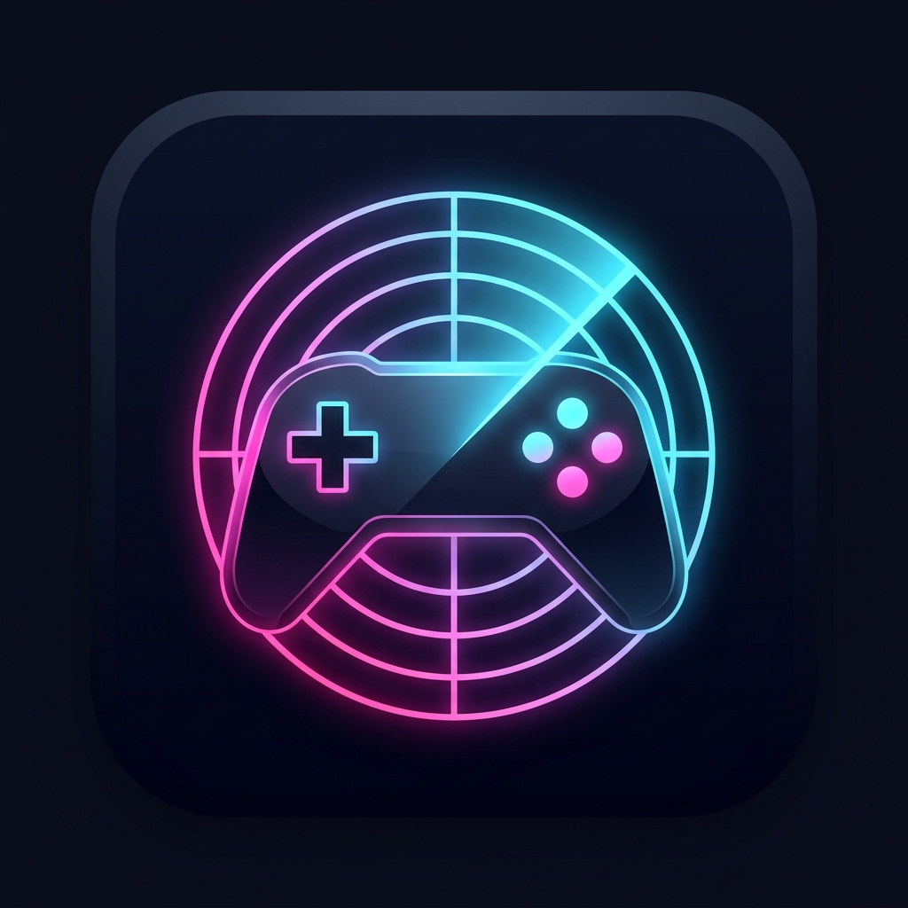

<p align="center">
  
</p>

<h1 align="center">Markas Gamer</h1>

<p align="center">
  Aplikasi pendamping gamer PC untuk mencatat progress & backlog game secara offline serta menemukan spot warnet/mabar terdekat, dibalut tema <strong>Vice Synthwave</strong> (Dark & Light Mode).
</p>

<p align="center">
  
</p>

---

## Fitur Utama

- **Beranda (`/`):** Ringkasan gaming hub, akses cepat tambah catatan game, dan status lokasi perangkat.
- **Catatan Game (`/catatan`):**
  - Daftar game tersimpan dengan banner cover, status (`PLAYING`, `BACKLOG`, `COMPLETED`), nama spot bermain, dan jarak dari lokasi saat ini.
  - Pencarian catatan game & pop-up konfirmasi sebelum menghapus.
  - Penyimpanan lokal menggunakan **SQLite (`sqflite`)** di Android/iOS (dengan fallback otomatis di Web).
- **Tambah Catatan Game (`/catatan/baru`):**
  - Pilih status game dan gambar cover (`FPS / Esports`, `RPG Fantasy`, `Cyberpunk`, `Synthwave`).
  - Input nama warnet/tempat bermain dengan opsi **Lokasi Live (GPS)** atau **Input Manual** (`Latitude` & `Longitude`), atau tanpa lokasi.
- **Radar Spot Warnet (`/lokasi`):**
  - Peta interaktif **OpenStreetMap** (`flutter_map`) lengkap dengan marker spot gaming, zoom `+`/`-`, dan tombol recenter.
  - Informasi spot terdekat, spesifikasi PC, jarak otomatis, dan alamat hasil reverse geocoding **OSM Nominatim**.
- **Tema Adaptif (`/tentang`):** Mendukung **Dark Mode (Vice Synthwave)** dan **Light Mode** yang dapat diganti langsung dari halaman Profil & Pengaturan.

---

## Teknologi & Package

| Package | Kegunaan |
| :--- | :--- |
| `go_router` | Navigasi antar halaman |
| `sqflite` & `path` | Database SQLite lokal |
| `geolocator` | Mengambil lokasi GPS & menghitung jarak |
| `flutter_map` & `latlong2` | Peta interaktif OpenStreetMap |
| `http` | Reverse geocoding alamat via OSM Nominatim |

---

## Struktur Proyek

```text
lib/
├── main.dart               # Entry point aplikasi
├── app.dart                # Konfigurasi MaterialApp.router & tema
├── models/
│   └── catatan.dart        # Model data catatan game
├── pages/
│   ├── home_page.dart      # Halaman Beranda
│   ├── notes_page.dart     # Daftar Catatan Game
│   ├── note_form_page.dart # Form Tambah Catatan Game
│   ├── location_page.dart  # Radar Spot Warnet & Peta
│   └── about_page.dart     # Profil & Pengaturan Tema
├── router/
│   └── app_router.dart     # Konfigurasi rute go_router
├── services/
│   ├── catatan_db.dart     # Repository SQLite lokal
│   └── lokasi_service.dart # Layanan GPS & OSM Nominatim
├── theme/
│   └── app_theme.dart      # Palet warna Vice Synthwave (Dark & Light)
└── widgets/
    ├── app_header.dart     # AppBar kustom dengan logo
    └── bottom_nav_shell.dart # Bottom Navigation Bar
```

---

## Cara Menjalankan

1. **Clone repository:**
   ```bash
   git clone https://github.com/Hanif3008/Markas-Gamer.git
   cd Markas-Gamer
   ```
2. **Install dependencies:**
   ```bash
   flutter pub get
   ```
3. **Jalankan aplikasi** (pastikan emulator Android atau perangkat terhubung):
   ```bash
   flutter run
   ```
4. **Jalankan unit/widget test:**
   ```bash
   flutter test
   ```
